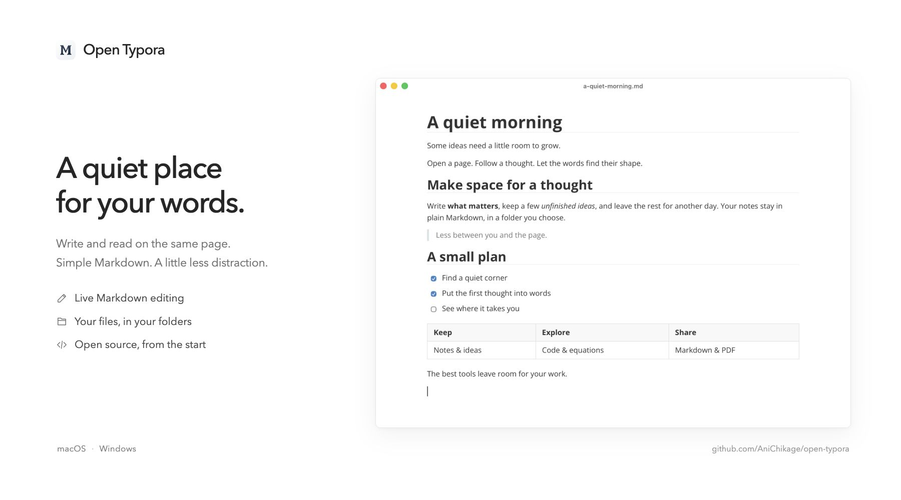

<p align="center">
  
</p>

<h1 align="center">Open Typora</h1>

<p align="center">Write in Markdown. Work directly on the page. Keep your files.</p>

<p align="center">
  English · <a href="README.zh-CN.md">简体中文</a><br>
  <a href="https://open-typora.comicyueyu.chatgpt.site">Try in your browser</a> · <a href="https://github.com/AniChikage/open-typora/releases/latest">Download</a> · <a href="#features">Features</a> · <a href="CONTRIBUTING.md">Contributing</a> · <a href="LICENSE">MIT License</a>
</p>

> [!IMPORTANT]
> **Open Typora is an independent, unofficial project. It is not developed, endorsed, or supported by Typora, and is not an official free edition.**
>
> If you can afford it, please **[buy Typora](https://store.typora.io/)** and support its official developers. Visit **[typora.io](https://typora.io/)** for the official product and support.



Open Typora is an open-source Markdown editor inspired by Typora's inline editing experience. Write directly in the rendered document, switch to source when you need it, and save ordinary `.md` files in your own folders.

**Status:** early development, version **0.15.0**. Release builds support **macOS 14+ on Apple Silicon**, **Windows 10/11 x64**, and **Linux x64**. The interface is currently in Simplified Chinese. This is an independent project, unaffiliated with Typora; full feature and behavior parity is still in progress.

## Features

- **Live Markdown editing** — headings, inline formatting, lists, tasks, tables, links, footnotes, and YAML front matter. Edit code and formulas in place, or switch to the full source view.
- **Tabs and split editing** — reorder and navigate document tabs, compare two documents side by side or stacked, and use independent source/live modes. Restore the pane layout on restart.
- **Responsive editing** — initialize documents on first use, reuse unchanged blocks, and edit large files directly in a virtualized rendered document, with incremental block parsing, delta undo history and background outline analysis; [benchmarks and limits](docs/performance.md).
- **A focused writing space** — outline navigation, focus and typewriter modes, word counts, find and replace, six built-in themes, and local CSS themes.
- **Theme customization** — per-theme fonts, spacing, width and colors, live CSS, print-only CSS, and CSS export. [Theme guide](docs/themes.md).
- **Personal backgrounds** — choose a local image, preview opacity, blur and placement, and keep it across restarts. Live and source modes share the background; exported documents stay free of it.
- **Community plugins** — six bundled, adapted typora_plugin plugins; local CommonJS files and folders with relative JS/JSON/CSS modules, configuration, shortcuts, and unloading. [Compatibility scope](docs/plugins.md).
- **Files you control** — folder tree, full-text search, quick open, recent files, autosave, session recovery, and external-change conflict detection.
- **Images, math, and diagrams** — local and pasted images, path and size controls, offline MathJax, Mermaid, and a [legacy sequence/flow subset](docs/diagrams.md). Optional image uploads use a configured PicGo Server.
- **More than UTF-8** — UTF-16 LE/BE, GB18030, GBK, Big5, Shift JIS, and Windows-1252. Preserve BOM and line endings; reject saves that would lose characters.
- **Import and export** — built-in HTML and PDF export with manual/chapter breaks, repeated table headers and widow/orphan controls; [pagination guide](docs/printing.md). Additional formats such as DOCX, ODT, RTF, and EPUB through [Pandoc](https://pandoc.org/).

- **Windows Markdown preview** — an opt-in native preview handler for Everything and File Explorer. Requires Microsoft Edge WebView2 Runtime. [Setup and limits](docs/windows-preview.md).

See the [feature checklist](docs/feature-parity.md) for coverage and known differences.

[Watch the editing demo](docs/images/editing-demo.gif) · [Project introduction and walkthrough (中文)](docs/introducing-open-typora.zh-CN.md)

Trying the preview? [Report a problem](https://github.com/AniChikage/open-typora/issues/new?template=bug_report.yml) or [suggest a feature](https://github.com/AniChikage/open-typora/issues/new?template=feature_request.yml). Include your platform, app version, and a small reproducible example.

## Getting started

### Try without installing

**[Open the web demo](https://open-typora.comicyueyu.chatgpt.site)** to edit a sample, switch between live and source modes, open a UTF-8 Markdown file, and download your work. It uses the same editing kernel as the desktop app.

The demo keeps documents in the current tab's memory; it does not upload or persist their contents. Refreshing clears edits, so download a copy before leaving. Imports are limited to 1 MB and external embedded media are blocked. Local folders, recovery, other encodings, and PDF / HTML export are available in the desktop app.

### Downloads

| Platform | Installer | Alternative |
| --- | --- | --- |
| Windows 10/11 · x64 | **[Download Setup.exe](https://github.com/AniChikage/open-typora/releases/download/v0.15.0/Open-Typora-0.15.0-windows-x64-Setup.exe)** | [ZIP](https://github.com/AniChikage/open-typora/releases/download/v0.15.0/Open-Typora-0.15.0-windows-x64.zip) |
| macOS 14+ · Apple Silicon | **[Download DMG](https://github.com/AniChikage/open-typora/releases/download/v0.15.0/Open-Typora-0.15.0-arm64.dmg)** | [ZIP](https://github.com/AniChikage/open-typora/releases/download/v0.15.0/Open-Typora-0.15.0-arm64.zip) |
| Linux · x64 | **[Download DEB](https://github.com/AniChikage/open-typora/releases/download/v0.15.0/Open-Typora-0.15.0-linux-x64.deb)** | [AppImage](https://github.com/AniChikage/open-typora/releases/download/v0.15.0/Open-Typora-0.15.0-linux-x64.AppImage) |

[SHA-256 checksums](https://github.com/AniChikage/open-typora/releases/download/v0.15.0/SHA256SUMS.txt) · [All releases](https://github.com/AniChikage/open-typora/releases)

### Install on Linux

Ubuntu 22.04 or a compatible x64 distribution is the tested baseline. Download the DEB and install it with:

```sh
sudo apt install ./Open-Typora-0.15.0-linux-x64.deb
```

The desktop launcher and Markdown file association are included. Uninstalling with `sudo apt remove open-typora` retains your documents and recovery data.

For other compatible distributions, make the AppImage executable (`chmod +x Open-Typora-0.15.0-linux-x64.AppImage`) and run it. FUSE 2 may be required. If FUSE is unavailable, extract it with `./Open-Typora-0.15.0-linux-x64.AppImage --appimage-extract` and run `./squashfs-root/AppRun`. CI exercises the extracted AppImage payload; FUSE mounting and every desktop environment have not been manually verified. Do not disable Chromium's sandbox to run the application.

Additional document conversion on Windows/Linux requires [Pandoc](https://pandoc.org/installing.html). ODT imports with older Pandoc 2.x also require LibreOffice to retain equations and headers. Legacy DOC/RTF imports also require [LibreOffice](https://www.libreoffice.org/download/download-libreoffice/), detected from its standard installation or PATH. Image copy, move, rename, download and Trash operations are available on all three platforms.

### Install on Windows

Run **Setup.exe**, choose an installation folder, and launch Open Typora from the Start menu. The installer also provides an optional desktop shortcut and Markdown file associations. Updates install into the same application folder; uninstalling preserves your recovery data.

To preview Markdown without opening the editor, enable **系统 Markdown 预览** in Preferences, then show the preview pane in Everything or File Explorer. This is optional and restores the previous handler when disabled. See the [preview guide](docs/windows-preview.md).

The Windows build is currently **not code-signed**. Windows may display an unknown-publisher or SmartScreen notice. Only use downloads from this repository's Releases page and verify the checksum if needed.

### Install on macOS

1. Download **[Open-Typora-0.15.0-arm64.dmg](https://github.com/AniChikage/open-typora/releases/download/v0.15.0/Open-Typora-0.15.0-arm64.dmg)** from [Releases](https://github.com/AniChikage/open-typora/releases/latest).
2. Open the DMG and drag **Open Typora** into **Applications**.
3. Launch Open Typora from Applications.

Requires **macOS 14 or later on Apple Silicon**. A ZIP alternative and SHA-256 checksums are included in the release. No Node.js, Xcode, or Typora installation is needed to use the app.

The application is locally signed and **not Apple-notarized**. macOS may ask you to approve opening it in **System Settings → Privacy & Security**. See [Apple's instructions](https://support.apple.com/en-us/102445). Never disable Gatekeeper to install it.

### Build from source

All platforms need **Node.js 26** and npm. A Typora installation is not required. On macOS, also install the **Xcode Command Line Tools** (`xcode-select --install`).

```sh
git clone https://github.com/AniChikage/open-typora.git
cd open-typora
npm ci
npm run package:mac
```

Open `release/native/Open Typora.app`, or install it in `~/Applications`:

```sh
node scripts/install.mjs
```

Quit a running Open Typora before replacing it. The installer preserves application data and removes the previous application after verifying the replacement. The build also produces a ZIP in `release/native/`; `npm run package:release` builds the DMG and checksum file too.

On Windows x64, also install Visual Studio 2022 Build Tools with the Desktop development with C++ workload and PowerShell 7 (`pwsh`). The build compiles the native preview handler using a pinned WebView2 SDK. Use the same clone and install steps, then build the installer:

```sh
npm run package:win
```

The EXE installer and ZIP are written to `release/windows/`. Build Windows releases on Windows x64. Intel Macs and Windows/Linux ARM do not yet have verified release builds.

On Linux x64, run `npm run package:linux` to produce DEB and AppImage files in `release/linux/`. Linux releases are built and tested on Ubuntu 22.04.

For additional document formats, install [Pandoc](https://pandoc.org/installing.html), then select its executable in Preferences if it is not detected. Pandoc is optional for writing Markdown and exporting HTML/PDF. On Windows/Linux, install LibreOffice as well to import legacy DOC/RTF. Imported embedded images are extracted to persistent local storage; conversions can change formatting.

### First steps

Open a Markdown file or a folder, or try [the example document](examples/a-quiet-morning.md). Click the text to edit it. Enter continues a list or creates a paragraph; Tab moves through table cells.

| Action | macOS | Windows / Linux |
| --- | --- | --- |
| New document | `⌘N` | `Ctrl+N` |
| Open a file | `⌘O` | `Ctrl+O` |
| Save | `⌘S` | `Ctrl+S` |
| Toggle source view | `⌘/` | `Ctrl+/` |
| Find in the document | `⌘F` | `Ctrl+F` |
| Search the folder | `⌘⇧F` | `Ctrl+Shift+F` |
| Quick open | `⌘⇧O` | `Ctrl+P` |
| Select word / delete word | `⌘D` / `⌘⇧D` | `Ctrl+D` / `Ctrl+Shift+D` |
| Select line / table row | `⌘L` | `Ctrl+L` |
| Select scope / table cell | `⌘E` | `Ctrl+E` |
| Jump to selection | `⌘J` | `Ctrl+J` |

## Development

```sh
npm ci
npm run dev:app
```

To work on the standalone browser demo, use `npm run dev:demo`; `npm run build:demo` writes the static site to `dist-demo/`. Its entry point is `src/demo/`, with a separate content security policy in `web/index.html`.

The Windows/Linux apps and development host use **Electron/Chromium**. The macOS app uses **Swift/AppKit + WKWebView**. Both share the same TypeScript/React interface and independently implemented editing model.

```sh
npm test                  # Editor and file-layer unit tests
npm run build             # Type checking and production frontend build
npm run test:native       # macOS filesystem tests
npm run test:webkit       # Native WebKit integration tests; requires Pandoc
```

More editor and desktop suites, test isolation, and build details are in [CONTRIBUTING.md](CONTRIBUTING.md). See [the architecture](docs/architecture.md) for the document model, editing history, and native bridge.

## Current limitations

- Documents are limited to 20 MB. Files over 300,000 characters open in source mode.
- Legacy encodings without a BOM require an explicit encoding choice.
- Rich editing and source editing have separate undo histories; changes made in source mode join the rich history as one transaction when returning.
- Format conversion can change layout or unsupported document structures. Some RTF image formats are rejected explicitly. Keep the original file when importing.
- Windows/Linux DOC/RTF import requires both Pandoc and LibreOffice. Embedded WMF/EMF images need conversion to PNG/JPEG first. Physical input-method candidates on Windows/Linux still need manual acceptance; automated text input is not equivalent to that check.
- Third-party themes, embedded media, input methods, and image-host integrations vary in compatibility. Consult the [checklist](docs/feature-parity.md) before depending on a specific workflow.

## Contributing

Bug reports, focused fixes, documentation, and reproducible compatibility examples are welcome. Start with [the contribution guide](CONTRIBUTING.md), then open an [issue](https://github.com/AniChikage/open-typora/issues) or a pull request.

## License

[MIT](LICENSE). Third-party dependencies retain their own licenses; the packaged application includes their notices. Open Sans is licensed under OFL, and MathJax and its bundled fonts use Apache-2.0.
