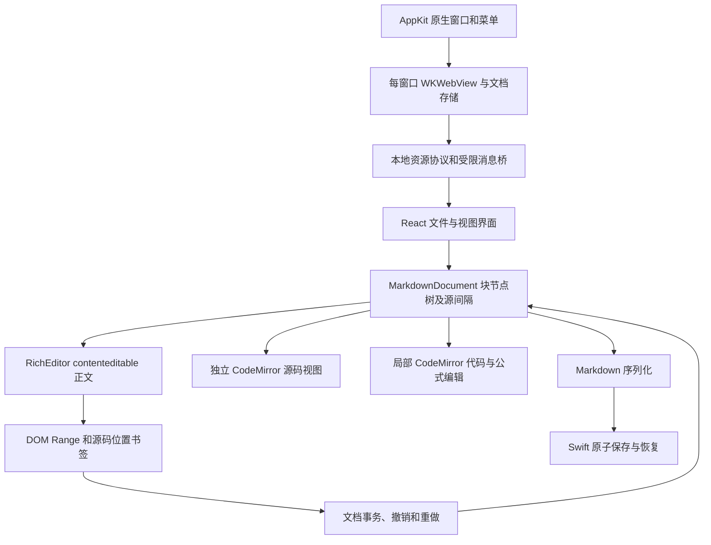

# 0.2.0 编辑架构

macOS 的发布包使用 Swift/AppKit + WKWebView。Electron 保留为跨平台开发与 Chromium 回归测试宿主，不是 `package:mac` 或 `install:app` 的发布入口。

## 文档与正文

`model.ts` 持有块节点、原始源间隔、稳定节点 ID、Markdown 位置和选区。序列化将块节点与源间隔按顺序拼回 Markdown，未编辑文档返回原始字节对应的文本。BOM 由原生存储层保留；LF/CRLF、前言与空白由模型及存储共同保留。

`RichEditor.ts` 的正文是实际可编辑 DOM。`beforeinput` 将输入、删除和结构操作转换为文档事务，再更新有变化的块；没有变化的块保留原来的 DOM 对象。行内语法由 markdown-it 识别，DOM 保留原始分隔符并仅在折叠光标所在的行内节点展开。图片和公式显示与源码分别存在，光标位置不依赖渲染后的文字长度。

组合输入期间停止重绘对应 DOM。提交时对编辑叶做最小差异更新，保留多行引用/列表的容器前缀，并作为一个撤销操作。切模式也会等待组合输入结束。跨块替换、段落合并/拆分、任务开关、表格增删及对齐通过同一事务层实现。

源码视图是单独的 CodeMirror 实例，读取模型的源码并将修改送回同一事务层；代码块和公式使用局部 CodeMirror。正文与代码块共用历史；源码模式进入后建立独立历史，返回正文时把源码修改合并成一次事务，并恢复正文历史。模式之间保留选区书签。原生菜单根据当前模式的历史启用或禁用撤销/重做。

MathJax 4 SVG 与 New Computer Modern 字体打包在本机，按文档顺序解析 TeX 宏。公式与 Mermaid 在需要时加载。导出等待公式、图表和字体完成后，使用独立 WebKit 导出视图异步生成向量 PDF，再按 A4 尺寸分页。原来的同步 NSPrintOperation 在真窗口测试中出现异常多页和卡顿，已移除；导出带有时限与页数限制。

## 原生窗口与文件

原生 New/Open 菜单创建独立窗口；每个窗口有自己的 WebKit、DocumentStore、文档模型与会话文件。已打开的同一文件优先切到对应窗口。旧 0.1.x 主会话格式继续兼容；额外窗口在 `windows/<id>/session.json` 恢复，显式关闭窗口先处理每份未保存文档的保存／取消／不保存决定，然后提交会话并标记为 closed。应用退出则保留全部恢复会话。

前端只传文档 ID，Swift 根据已打开/已恢复的记录管理文件授权。保存使用相邻临时文件、完整写入、fsync、提交前再次比较磁盘哈希和原子 rename。普通保存遇到外部修改会保留草稿并报冲突。图片协议仅解析已授权文档目录内的相对路径，拒绝目录穿越和指向目录外的符号链接。

桥只接受本地应用来源的主 frame。远程图片默认显示引用说明，原始 HTML 不作为可执行内容加载。用户数据没有随应用打包或复制到源码目录。

## 验证入口与边界

- `npm test`：文档内核与 Electron 文件层的单元检查。
- `npm run test:native`：Swift 文件层真实文件系统检查。
- `npm run test:webkit`：隔离数据、隐藏 WebKit 实例中的实际渲染/桥/保存检查，未使用用户窗口。
- `npm run test:desktop`：Electron/Chromium 下的编辑、保存、图片、PDF、冲突与恢复回归。
- `npm run test:kernel-desktop`：实际键盘/DOM 下的代码和公式键入、模式历史、嵌套代码、查找及快捷键回归。
- `npm run package:mac`：构建和签名原生 macOS 包。

安装版窗口、系统文件面板、格式内输入/自动保存、源码快捷键与菜单、模式历史、重启恢复及 PDF 已进行真窗口检查；预览版另外回放了保存／取消／不保存关闭流程。具体证据与未验证项见 [verification.md](verification.md)。自动化结果不替代真窗口检查，实体输入法和官方完整交互仍需继续逐项对照。

本模型仍是独立的 source-backed 块树，不是官方内部节点类的复制。CommonMark 扩展、全文重解析、快照型事务和大文件源码回退与官方内部实现存在差异；具体研究范围见 [research.md](research.md)。
