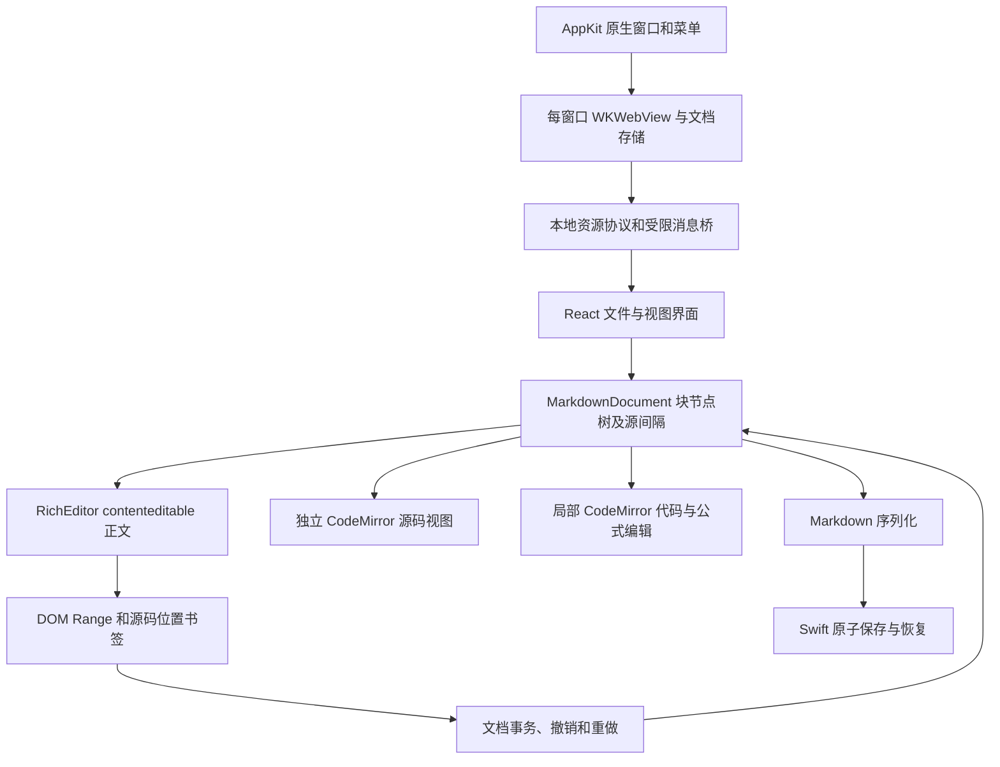

# 编辑架构（0.13.4）

macOS 的发布包使用 Swift/AppKit + WKWebView。Windows/Linux 发布包使用 Electron/Chromium，并保留为跨平台开发与回归测试宿主；macOS 的 `package:mac` 与 `install:app` 仍使用原生宿主。Windows 使用系统标题栏、Ctrl 快捷键与单实例文件打开，`package:win` 生成 NSIS 安装包与 ZIP。

## 文档与正文

`model.ts` 持有块节点、原始源间隔、稳定节点 ID、Markdown 位置和选区。序列化将块节点与源间隔按顺序拼回 Markdown，未编辑文档返回原始字节对应的文本。BOM 由原生存储层保留；LF/CRLF、前言与空白由模型及存储共同保留。

`RichEditor.ts` 的正文是实际可编辑 DOM。`beforeinput` 将输入、删除和结构操作转换为文档事务，再更新有变化的块；没有变化的块保留原来的 DOM 对象。行内语法由 markdown-it 识别，DOM 保留原始分隔符并仅在折叠光标所在的行内节点展开。图片和公式显示与源码分别存在，光标位置不依赖渲染后的文字长度。

组合输入期间停止重绘对应 DOM。提交时对编辑叶做最小差异更新，保留多行引用/列表的容器前缀，并作为一个撤销操作。切模式也会等待组合输入结束。跨块替换、段落合并/拆分、任务开关、表格增删及对齐通过同一事务层实现。

源码视图是单独的 CodeMirror 实例，读取模型的源码并将修改送回同一事务层；代码块和公式使用局部 CodeMirror。正文与代码块共用历史；源码模式进入后建立独立历史，返回正文时把源码修改合并成一次事务，并恢复正文历史。模式之间保留选区书签。原生菜单根据当前模式的历史启用或禁用撤销/重做。

MathJax 4 SVG 与 New Computer Modern 字体打包在本机，按文档顺序解析 TeX 宏。公式与 Mermaid 在需要时加载。导出等待公式、图表和字体完成后，使用独立 WebKit 导出视图异步生成向量 PDF，先依据文本行、段落、标题及表格行计算分页，再逐页调用 WebKit PDF 渲染并合成带页眉页脚的 A4/Letter 文件。每页独立采集，避免通过裁切同一大页面产生重复文本层。原来的同步 NSPrintOperation 在真窗口测试中出现异常多页和卡顿，已移除；导出带有时限与页数限制。

## 原生窗口与文件

New/Open 在当前窗口中新建或打开页签，New Window 创建独立 macOS 窗口；每个窗口有自己的 WebKit、DocumentStore、文档模型与会话文件。已打开的同一文件优先切到对应窗口。旧 0.1.x 主会话格式继续兼容；额外窗口在 `windows/<id>/session.json` 恢复，显式关闭窗口先处理每份未保存文档的保存／取消／不保存决定，然后提交会话并标记为 closed。应用退出则保留全部恢复会话。

前端只传文档 ID，Swift 根据已打开/已恢复的记录管理文件授权。保存使用相邻临时文件、完整写入、fsync、提交前再次比较磁盘哈希和原子 rename。普通保存遇到外部修改会保留草稿并报冲突。资源协议按已打开的文档解析相对/绝对图片和媒体路径，支持 YAML 本地根目录，拒绝符号链接及超过限制的资源。已打开同一路径时保持原来的磁盘哈希，避免再次打开默默接受外部修改。

桥只接受本地应用来源的主 frame。远程图片可在偏好中关闭。HTML 使用 CommonMark 块解析、清理后的预览与独立局部源码编辑；脚本/事件属性和伪造编辑器属性会被清理。HTTPS iframe 置于沙盒，媒体资源与正文消息桥隔离。用户数据没有随应用打包或复制到源码目录。

## 命令与功能扩展

`shared/commands.json` 是菜单、快捷键和前端命令入口的共同定义。AppKit 根据正文/源码和表格上下文禁用不适用项。`blockCommands.ts` 对源行执行段落转换，保留容器前缀和选区；每个动作只提交一份历史事务。行内格式跨多个编辑叶时分别应用，避免破坏列表和段落结构。表格移动同时移动对齐定义和单元格内容。

`markdownExtensions.ts` 为目录、脚注、前言、注释和受限 HTML 建立源位置映射。正文目录根据全部标题更新，脚注定义可直接编辑；源码始终保留用户输入的形式。偏好通过编辑器配置重新渲染，关闭某项扩展不重写文件。粘贴优先采用自有 Markdown 类型，其次把经清理的 HTML 转成 Markdown。

原生标签组用每窗口的 `tab-group` 标识恢复。关闭文档先完成保存/取消/不保存决策和会话提交；重新打开已保存文件重新读取磁盘内容。跨文件 Markdown 链接在已打开文件夹范围内解析，带标题锚点的打开动作在目标窗口就绪后执行。未创建的目标文档由原生对话框提供创建操作。

HTML 导出在请求时生成独立正文，等待公式和图表，通过本地资源桥嵌入字体及已授权图片。普通输入不持续生成导出 DOM。源码和局部代码编辑器的自动配对与缩进设置通过配置 compartment 更新。

## 验证入口与边界

- `npm test`：文档内核与 Electron 文件层的单元检查。
- `npm run test:native`：Swift 文件层真实文件系统检查。
- `npm run test:webkit`：隔离数据、隐藏 WebKit 实例中的实际渲染/桥/保存检查，未使用用户窗口。
- `npm run test:desktop`：Electron/Chromium 下的编辑、保存、图片、PDF、冲突与恢复回归。
- `npm run test:kernel-desktop`：实际键盘/DOM 下的代码和公式键入、模式历史、嵌套代码、查找及快捷键回归。
- `npm run test:encoding`：编码状态/转换、不可表示字符、BOM 外部变化、合成组合输入与磁盘冲突、未命名源码多图粘贴。
- `npm run test:features`：目录、标题、表格对话框、专注/打字机、偏好、快速打开、文件树及重新打开回归。
- `npm run package:mac`：构建和签名原生 macOS 包。

安装版窗口、系统文件面板、格式内输入/自动保存、源码快捷键与菜单、模式历史、重启恢复及 PDF 已进行真窗口检查；预览版另外回放了保存／取消／不保存关闭流程。具体证据与未验证项见 [verification.md](verification.md)。自动化结果不替代真窗口检查，实体输入法和官方完整交互仍需继续逐项对照。

本模型仍是独立的 source-backed 块树，不是官方内部节点类的复制。CommonMark 扩展、全文重解析、快照型事务和大文件源码回退与官方内部实现存在差异；具体研究范围见 [research.md](research.md)。

## 0.4 文件与导出事务

`Workspace.swift` 管理稳定目录 token、空文件夹、最近项目/置顶、内容搜索、文件复制/重命名/移动/废纸篓和一次文件操作撤销。重命名前每个窗口先等待保存完成并提交当前草稿，暂停自动保存；修改磁盘路径后更新所有窗口的文件记录及恢复会话，再释放输入锁并返回完成。输入法仍在组词时取消文件操作。目录刷新不重载编辑器内容。

图片复制规则优先读取文档 YAML，再读取本机偏好。图片文件操作与文本撤销分开；移动使用先复制全部资源、再把旧文件移到废纸篓，避免中途失败后丢失尚未重写的引用。PicGo 接口使用原生 URLSession，显式上传与自动上传设置共用同一入口；不会把接口测试宣称为真实图床交付。

`Interchange.swift` 在后台运行有时限的文档转换器。Pandoc 可配置；未安装时，macOS Word/RTF/ODT 转换使用系统 textutil。主题安装只打包选中 CSS 引用的本地字体和图片，限制目录与总大小，再将 Typora 的正文/侧栏选择器映射到本应用。

## 0.5 编码与复杂转换

文档记录新增可选 `encoding`，兼容原有恢复数据。Unicode 按 BOM 识别；其他编码显式选择。原生层使用 Foundation/CoreFoundation，开发宿主使用 TextDecoder/iconv-lite；保存前逐码点检查往返一致，编码失败不更改文件或归属记录。保存、复制、磁盘接受、恢复均保留编码与 BOM。转换编码不改变编辑内核的内容历史。

输入法组词时跳过磁盘内容刷新，保存/关闭/重开须先完成组合；异步检查后若已开始组词则保留草稿并标记冲突。普通保存不能绕过未解决的冲突。

导出时才准备转换用 Markdown，解析图片引用并读取实际资源，将 Mermaid SVG 转为高分辨率 PNG；正文 Markdown 与撤销历史保持不变。Pandoc 处理原生公式、脚注、表格，HTML 块通过本地 Lua 过滤器转为结构节点。包格式嵌入资源；文本格式写同名资源文件夹。导入使用 GFM 输出，避免把编辑器不支持的 simple/grid table 作为纯文本返回；媒体提取至应用持久目录。

RTF 由 Cocoa 解析表格，提前保留 PNG/JPEG、脚注、语义标题和等宽代码，再恢复为 Markdown；解析器限制分组深度、数量与时间。无法保留的图片格式明确报错。发布仍是 AppKit/WebKit；Chromium 回归和合成 composition 检查不作为实体输入法成功的证据。

0.5.1 修复组合开始时的空元素光标：选择节点本身是元素时，从该元素查找编辑叶，避免跳到父段落后漏记提交；浏览器原生输入同步共用同一定位。回归覆盖新建空段落、一次组合提交、撤销/重做及源码保真。本机搜狗人工输入的“你好，中国”另经安装版正文、历史、源码往返和 UTF-8 文件字节检查；该结果不代表所有候选状态与编辑位置已穷尽。

## 0.8 平台发布与交互

Windows/Linux 共用受限 Electron 桥与最小依赖打包，Linux 增加 DEB/AppImage、desktop 文件与 Markdown MIME 类型。`launchFiles` 解码本地文件 URL，第二实例将文档交给已有窗口。`shared/commands.json` 的 `key` 保留 Mac 绑定，`pcKey` 提供 Windows/Linux 绑定；菜单、前端与插件快捷键预留使用对应平台配置。

列表多行缩进复用块级事务和选区映射，引用前缀只消耗一个分隔空格；局部代码使用 CodeMirror 的行缩进命令。表格 Cmd/Ctrl+Enter 使用现有插行事务，Shift+Enter 写入 ` `，不创建新的 Markdown 源行。

`legacyDiagrams.ts` 将 sequence/flow 的公开常用语法转为 Mermaid，仅影响渲染与导出，不重写原文。不支持的语法拒绝整张图，保留原文并显示错误；范围见 [diagrams.md](diagrams.md)。

## 0.9 选区与跨平台导入

选词通过 Unicode 分词找到文字范围，再映射回正文源位置；清空整个行内样式时同步移除空分隔符，删除与撤销保持单事务。表格选择限制在单元格或当前行；源码和局部代码通过 CodeMirror 选区 API 处理。只读状态保留选择和定位，阻止删词。

Electron 图片文件管理先检查全部目标冲突，再复制；失败清理本次新文件，全部复制成功后才将原文件移到系统废纸篓。DOC/RTF 通过独立配置目录中的 LibreOffice 转为 DOCX，再交给 Pandoc。DOCX/ODT/EPUB 导入媒体保存在应用目录，解析 AST 后仅重写资源目标；清理转换临时文件不移除成功导入的媒体。HTML 中的本地图片在清理前改为文档资源协议，保持本地授权与脚本清理边界。

## 0.11.0 组合输入与插件生命周期

正文提交在 compositionend 后等待一次事件循环，让 WebKit 的最终 input 先完成；取消候选不写空历史，独立候选提交在边界关闭撤销分组。跨段替换使用组合开始时的源位置映射；源码和局部 CodeMirror 编辑器同样保护提交边界。组合期间延迟模式切换与编辑选项更新，适配器文档写入明确拒绝并提示完成输入。非活动文档接收模式设置时不会夺取活动输入框的焦点。

插件事件区分加载与编辑；宿主提供有序和单次事件、解绑、动态快捷键与命令元数据。适配器拥有的定时器在禁用、失败、退出时释放，异步回调错误隔离到对应插件。列表折叠使用固定上游源码和有边界的会话状态记录，不修改 Markdown。宿主不提供完整 Node/Electron 或 Typora 私有接口。

插件文件夹由原生和 Electron 安装器分别收集有边界的 UTF-8 模块；共用 `shared/plugin-loader.js` 生成静态函数注册表，通过相对路径解析、模块缓存和 CommonJS 循环引用执行，不使用 eval。JSON 和 CSS 作为值嵌入已安装模块，运行时不读取原始文件夹。单文件插件也统一注入定时器，宿主负责停用清理。

跨段中文提交以组合开始时的源选区限制前后缀匹配，避免重复字符使替换越过段落分隔；可见文本相同的提交仍按源区间替换。浏览器替换整个段落元素时，使用组合快照恢复源位置并生成单次撤销。

## 页签、分屏与性能

`EditorWorkspace` 统一显示页签，并将两篇不同文档排成左右或上下窗格。同一文档始终保留一个编辑器实例；切换到已显示的文档会激活所在窗格，其他文档替换当前窗格。编辑器按首次查看初始化，查看后保持挂载，确保窗口存续期间的光标、滚动、源码模式与撤销历史不因切换或交换位置而丢失。React memo 与稳定回调隔离未改变的视图。插件的 `#write` 跟随 `data-active` 窗格，组合输入期间禁止切换或重排文档。

`workspace.ts` 校验两篇文档的身份、方向和尺寸，避免重复窗格、关闭文档后的悬空引用或无效比例。布局随每窗口 session 保存；旧 session 中不存在布局字段时按单窗格恢复。布局恢复不包含编辑模式、光标、滚动与撤销历史。

块匹配使用类型/源码索引并消费候选项，保留重复内容的独立身份；中间空段和文末空段也不能共用 ID。富文本渲染复用未改变块的 DOM 与叶映射，前方插入内容时平移位置并修正任务复选框偏移。文档引用、脚注、标题或 Markdown 偏好变化会使相应缓存失效。仍然全文解析；超过 30 万字符的文档使用源码视图。[性能基准](performance.md) 明确区分组件耗时与整应用输入延迟。
