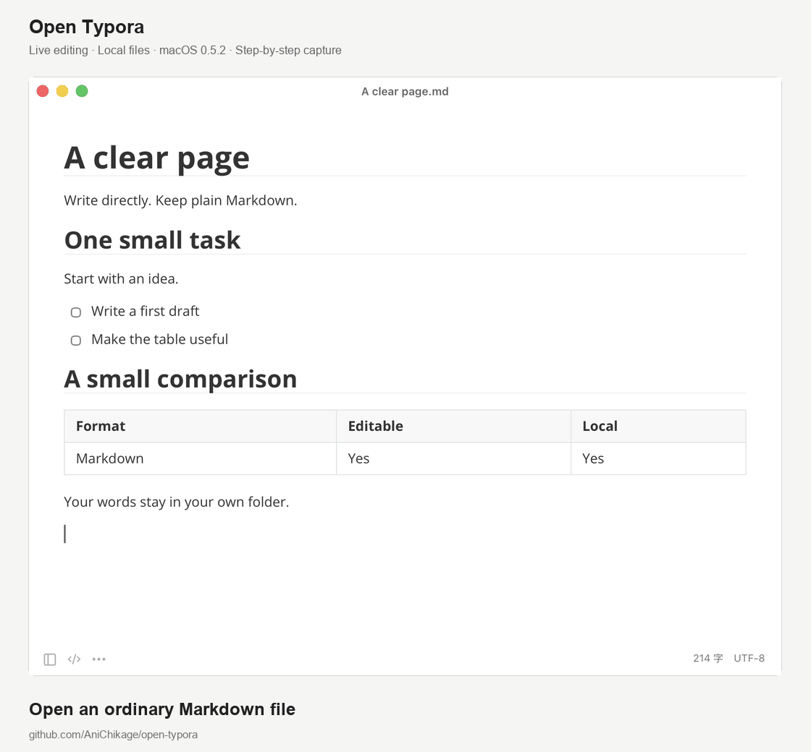

# Open Typora 开源 Markdown 编辑器与实际编辑演示

> 本文记录 0.5.2 的发布和操作演示，保留当时的功能范围。当前版本为 0.20.0，已提供 Linux 安装包和 AI 编辑等后续功能；最新下载、配置与限制请看[中文 README](../README.zh-CN.md)。

我把 Open Typora 开源了。现在有 macOS 和 Windows 安装包，可以直接下载试用。

我想要的东西很明确：打开一份 `.md` 文件，直接在正文里写。标题、列表、表格正常排版，需要看源码时再切过去。写完保存，文件还在自己的文件夹里，换个编辑器也能继续打开。

项目受 Typora 的编辑体验启发，采用 MIT 许可证，与 Typora 官方没有关联。本文对应 **0.5.2 早期预览版**，界面暂时只有简体中文。

## 编辑交互要实际用起来

对一个 Markdown 编辑器，我关心的不只是打开文档后长什么样。选中一句话再修改，光标应该留在对的位置；勾选任务后，源码也应该变；在表格里按 Enter、Tab，应该能继续写下去。最后还得把文件保存好。

所以这次也补了一段实际编辑演示。下面展示的是安装版 macOS 应用中的操作，用公开的示例文件走了一遍正文修改、任务勾选、表格加行、源码切换、保存和 PDF 导出。

动图由实际窗口截图按步骤整理，播放时长不代表操作耗时。文中的英文来自示例文档，应用菜单和提示目前仍为中文。

演示中先把一句 `Start with an idea.` 改成 `Start with a thought. Make it yours.`，再勾选一项任务。在表格里按 Enter 加一行，用 Tab 切换单元格，填入 PDF 的那一行。切到源码后，可以看到对应的文字、`[x]` 和新增表格行。

保存后的 [Markdown 文件](../examples/clear-page.md)和从同一份文档导出的 [PDF 文件](../examples/clear-page.pdf)也一起放在仓库里，可以对照查看。

## 0.5.2 的功能

日常写作里常见的标题、行内格式、列表、任务、表格、代码、脚注和 YAML 前言已经支持。公式使用离线 MathJax，图表使用 Mermaid。正文编辑和完整源码视图可以切换。

文档管理围绕本地文件展开：打开文件或文件夹，用文件树、全文搜索和快速打开定位内容。应用提供自动保存、会话恢复和外部修改冲突检测，使用不需要注册账号。

编码除了 UTF-8，还支持 UTF-16 LE/BE、GB18030、GBK、Big5、Shift JIS 和 Windows-1252。没有 BOM 的传统编码需要手动选择；保存时会检查目标编码无法表示的字符，避免直接丢掉内容。

HTML 和 PDF 可以直接导出。DOCX、ODT、EPUB 等额外格式通过可选的 Pandoc 转换。转换后的排版和文档结构可能变化，原文件还是要留着。

## 0.5.2 当时的兼容范围

这点得说清楚。现在可以下载安装，也有一批可用的编辑和文件操作，但完整的功能、输入法和交互兼容还在继续做。

- Windows 输入法候选交互还缺人工验收。自动输入中文通过，不能当作所有中文输入法都没问题。
- Windows 暂不支持旧 DOC/RTF 导入及图片批量文件操作。
- 正文与源码有各自的撤销历史，源码修改返回正文时合并为一次事务。
- 复杂格式转换、第三方主题和图床服务有各自的兼容范围。
- Intel Mac、Windows ARM 和 Linux 目前没有经过验收的发布构建。

完整范围写在[功能清单](feature-parity.md)里。选编辑器时，最好拿一份自己日常文档的副本，把常用流程跑完，再决定适不适合。

## 下载安装

请使用[当前版本的下载与安装说明](../README.zh-CN.md#下载)，提供 macOS、Windows 和 Linux 安装包。上方演示仍对应 0.5.2，不代表新版本的完整界面。

[Release 页面](https://github.com/AniChikage/open-typora/releases/latest)同时提供 ZIP 和 SHA-256 校验文件。Windows 安装包目前没有代码签名证书，macOS 包还没有经过 Apple 公证，首次安装可能出现系统提示。安装说明见[中文 README](../README.zh-CN.md#开始使用)。

如果你愿意试用，我更想知道具体卡在哪里：哪种输入法、哪份表格、哪一步保存或导出出了问题。附上系统、应用版本和最小复现示例，后面才好把问题真正修掉。

[源码仓库](https://github.com/AniChikage/open-typora) · [报告问题](https://github.com/AniChikage/open-typora/issues/new?template=bug_report.yml) · [提出功能建议](https://github.com/AniChikage/open-typora/issues/new?template=feature_request.yml)

本文使用 AI 辅助起草与整理。功能说明依据 0.5.2 项目文档，操作素材来自该版本 macOS 安装版的实际窗口。
